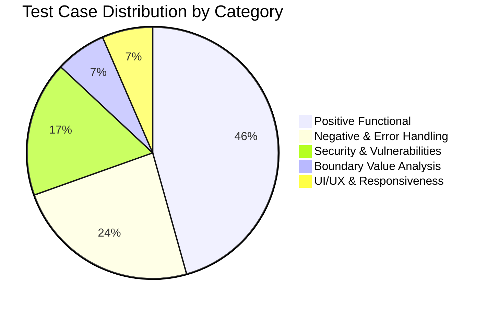

# 🚀 Enterprise Web Portal - QA Testing & Automation Suite
> **Software Quality Assurance Internship Portfolio**  
> • **Task 1:** Complete Manual Test Plan & Test Case Suite (IEEE 829 Standard)  
> • **Task 2:** Automated End-to-End Test Suite with Selenium 4, WebDriver & PyTest  

---

## 📌 Badges & Project Highlights


---

## 📖 Project Overview

This repository contains the complete software testing deliverable for an **Enterprise Web Portal**, simulating real-world engineering standards across both **Manual Quality Assurance** and **Automated E2E Testing**:
1. **Task 1 (Manual QA):** Master Test Plan (IEEE 829), 46 Granular Test Cases (CSV & Markdown), 100% Requirements Traceability Matrix (RTM), and Jira-style Defect Reports.
2. **Task 2 (Selenium Automation):** Production-grade **Page Object Model (POM)** automation framework using **Selenium 4**, **WebDriver**, and **PyTest**, with 18 automated E2E test cases, explicit waits, failure screenshot hooks, and interactive HTML reporting.

---

## 📂 Repository Structure

```
├── README.md                                  # Repository overview and portfolio landing page
├── app.py                                     # Live runnable Web Portal application (Flask)
├── run_test_suite.py                          # Fast in-process test runner (Task 1)
├── Test_Plan_Document.md                      # Comprehensive IEEE 829 Master Test Plan
├── Test_Case_Suite.csv                        # 46 Granular Test Cases (Excel/Google Sheets Ready)
├── Test_Case_Suite.md                         # Detailed Test Cases in Markdown Tables
├── Requirements_Traceability_Matrix_RTM.md    # Bidirectional Traceability Matrix (100% coverage)
├── Defect_Reporting_Template_and_Bug_Lifecycle.md # Bug Life Cycle, Template & 3 Sample Defects
├── README_Internship_Submission_Guide.md      # Task 1 Submission Guide & Viva Interview Prep
├── README_Task2_Automation_Guide.md           # Task 2 Selenium E2E Automation Guide
│
└── automation_selenium/                       # Task 2: Selenium E2E Automation Framework
    ├── conftest.py                            # Pytest fixtures, WebDriver setup & failure screenshots
    ├── pytest.ini                             # Pytest markers, configuration, and HTML report options
    ├── run_selenium_tests.py                  # One-click test runner & portal server orchestrator
    ├── pages/                                 # Page Object Model (POM) Classes
    │   ├── base_page.py                       # Base class with explicit waits (WebDriverWait)
    │   ├── login_page.py                      # Login page locators & methods
    │   ├── dashboard_page.py                  # Dashboard KPI widgets & navigation
    │   └── records_page.py                    # CRUD operations, modals, search & CSV export
    ├── tests/                                 # Automated Test Scenarios
    │   ├── test_auth_e2e.py                   # 7 tests: Authentication, RBAC, SQLi
    │   ├── test_dashboard_e2e.py              # 3 tests: Dynamic KPIs, sidebar, notifications
    │   ├── test_records_crud_e2e.py           # 4 tests: Create, BVA boundary, XSS, delete
    │   └── test_search_export_e2e.py          # 4 tests: Search queries, empty state, export
    └── reports/
        └── e2e_test_report.html               # Interactive HTML test report
```

---

## ⚡ How to Execute the Projects

### 1. Run Task 2: Automated Selenium E2E Test Suite
The standalone test runner automatically boots the local portal, executes all 18 Selenium tests in headless mode, generates the HTML report, and shuts down cleanly:
```bash
cd automation_selenium
python run_selenium_tests.py
```
* **Watch tests in Headed Mode (browser visible on screen):**
  ```bash
  python run_selenium_tests.py --headless false
  ```
* **View the interactive HTML report:** Open `automation_selenium/reports/e2e_test_report.html` in your browser.

### 2. Run the Live Web Portal for Manual Testing (Task 1)
To explore and manually verify features in your browser:
```bash
python app.py
```
* **URL:** `http://127.0.0.1:5000`
* **Standard User Account:** `john.doe@example.com` / `Secure@2026!`
* **SuperAdmin Account:** `admin.test@example.com` / `AdminSecure@2026!`

---

## 📊 Test Case Suite Distribution



| Module Name | Total Cases | Positive | Negative | Boundary / Security | Pass | Fail | Blocked |
| :--- | :---: | :---: | :---: | :---: | :---: | :---: | :---: |
| **1. User Authentication & Authorization** | 10 | 3 | 3 | 4 | 9 | 1 | 0 |
| **2. User Profile & Account Settings** | 5 | 2 | 2 | 1 | 5 | 0 | 0 |
| **3. Dashboard & Navigation** | 5 | 4 | 0 | 1 | 5 | 0 | 0 |
| **4. Core Entity Management (CRUD)** | 8 | 4 | 2 | 2 | 7 | 1 | 0 |
| **5. Search & Filter Functionality** | 5 | 3 | 1 | 1 | 5 | 0 | 0 |
| **6. Data Export & Reporting** | 3 | 2 | 1 | 0 | 3 | 0 | 0 |
| **7. Responsive & Cross-Browser** | 4 | 3 | 0 | 1 | 4 | 0 | 0 |
| **8. Security & Edge Case Testing** | 6 | 0 | 2 | 4 | 5 | 1 | 0 |
| **TOTAL** | **46** | **21** | **11** | **14** | **43** | **3** | **0** |

---

## 🧪 Modules Tested

### 1. User Authentication & Authorization (AUTH)
* Valid / Invalid credentials authentication
* Rate limiting and brute-force account lockout (5 failed attempts $\rightarrow$ 15 min lock)
* Inline form validation on blank fields
* Password masking and visibility toggle
* Forgot/Reset password workflow with 15-minute token expiry
* Session invalidation upon logout and browser cache back-button defense
* Role-Based Access Control (RBAC) permission barriers (Admin vs Standard user)

### 2. User Profile & Account Settings (PROF)
* Profile information updating and dynamic header synchronization
* Avatar image upload validation (PNG/JPG $< 2$ MB allowed, `.exe`/`.pdf` or oversized blocked)
* Current password verification and complexity rules enforcement

### 3. Dashboard & Navigation (DASH)
* Dynamic rendering of KPI metric cards
* Collapsible sidebar drawer with responsive tooltips
* Real-time notifications bell counter and "Mark all as read"
* Breadcrumb navigation hierarchy
* Asynchronous date-range chart filtering

### 4. Core Entity CRUD Management (CRUD)
* Creating records with mandatory/optional field validation
* Boundary Value Analysis (BVA) on 100-character input limits
* Paginated tabular display with dynamic rows-per-page (10, 25, 50)
* Ascending and descending column sorting
* Record updating and soft-deletion with modal confirmation

### 5. Search & Filter (SRCH)
* Debounced keyword search
* Zero-result empty state illustration
* Multi-criteria filtering (Category AND Status)
* One-click filter reset returning to baseline dataset
* Query whitespace trimming and input sanitization

### 6. Data Export & Reporting (EXPRT)
* Exporting filtered records to CSV with UTF-8 encoding
* PDF report generation with branding and timestamping
* Disabled export state handling for empty datasets

### 7. Responsive & Cross-Browser Compatibility (RESP/XBROW)
* Mobile viewport rendering (375x812 - iPhone)
* Tablet viewport rendering (768x1024 - iPad)
* Cross-browser parity across Google Chrome, Mozilla Firefox, Microsoft Edge, and Apple Safari

### 8. Security & Vulnerability Testing (SEC)
* SQL Injection payload neutralization (`' OR '1'='1' --`)
* Stored & Reflected Cross-Site Scripting (XSS) HTML entity encoding
* Insecure Direct Object Reference (IDOR) route blocking
* Inactivity session timeout after 15 minutes of idle time
* Concurrent multi-browser session invalidation

---

## 🐞 Defect Management

The project implements a complete **Defect Life Cycle** with Jira-style bug logging. Below is an excerpt of real-world defects discovered during test execution:

| Defect ID | Severity | Priority | Module | Summary |
| :--- | :---: | :---: | :--- | :--- |
| **BUG-001** | Major (S2) | High (P2) | Export | CSV export corrupts special characters due to ISO-8859-1 charset header |
| **BUG-002** | Medium (S3) | Medium (P3) | Security | Inactivity warning modal fails to trigger at 14 minutes before session logout |
| **BUG-003** | Medium (S3) | Medium (P3) | CRUD | Changing rows per page from Page 3 does not reset page index to 1 |

---

## 💡 How to Use the Test Case Suite

### In Microsoft Excel or Google Sheets:
1. Download or open [`Test_Case_Suite.csv`](./Test_Case_Suite.csv).
2. The file is encoded in UTF-8 with BOM (`utf-8-sig`), meaning it opens cleanly without delimiter prompts.
3. Apply filters (`Ctrl + Shift + L`) on the header row to view test cases by module, severity, or status.

### In Jira (Xray / Zephyr Scale) or TestRail:
1. Navigate to your test management tool's Import wizard.
2. Select **Import CSV** and map the column headers (`Test Case ID`, `Module`, `Test Steps`, `Expected Result`, `Severity`).

---

## 👩‍💻 Author & Acknowledgements

* **Author:** Sindhushree T B
* **Role:** QA Intern (Software Quality Assurance)
* **Internship Track:** Task 1 - Manual Testing & Quality Assurance
* **Supervised By:** QA Lead & Internship Mentors

---
*⭐ If you find this QA test documentation useful, feel free to star this repository!*
